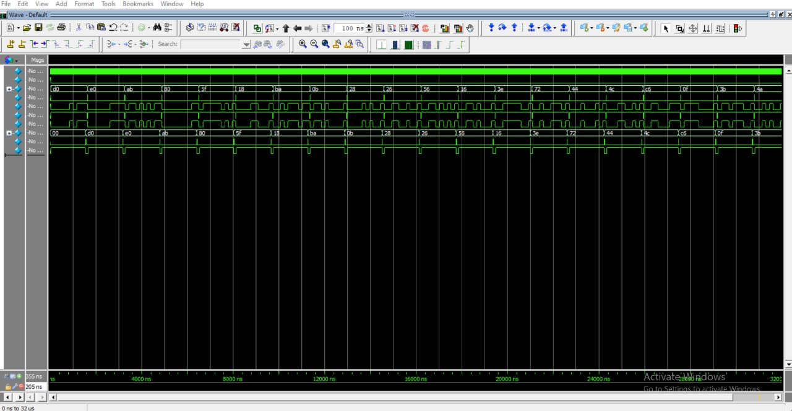

# UART Transmitter and Receiver Design and Verification Using SystemVerilog

## 1. Project Overview

This project implements a UART (Universal Asynchronous Receiver/Transmitter) communication system using SystemVerilog.

The design includes a UART Transmitter (TX) and UART Receiver (RX). The transmitter converts 8-bit parallel data into a serial UART data stream, while the receiver reconstructs the serial data into an 8-bit parallel value.

A SystemVerilog-based verification environment is used to generate transactions, drive stimulus, monitor communication, compare expected and actual data, and verify the design.

## 2. UART Communication

UART is an asynchronous serial communication protocol that transmits data one bit at a time.

A typical UART frame consists of:

- **Start bit:** Logic 0
- **Data bits:** 8 bits, transmitted least significant bit first
- **Stop bit:** Logic 1

### UART Frame Format

```text
       START          DATA BITS (LSB FIRST)           STOP
         |          D0 D1 D2 D3 D4 D5 D6 D7            |
         v                                               v
Idle ___| 0 |  0  1  0  1  0  1  0  1  | 1 |___ Idle
```

The data values shown in the diagram are illustrative. Actual transmitted bits depend on the input byte.

## 3. UART Transmitter (TX)

The transmitter accepts an 8-bit parallel input and converts it into serial data.

Its main functions are:

- Accepting input data for transmission
- Generating the start bit
- Transmitting data bits in least-significant-bit-first order
- Generating the stop bit
- Returning to the idle state after transmission

## 4. UART Receiver (RX)

The receiver detects incoming serial data and reconstructs the original byte.

Its main functions are:

- Detecting the start bit
- Sampling the incoming serial data
- Reconstructing the 8-bit data value
- Detecting the stop bit
- Making the received data available to the rest of the design

## 5. Verification Environment

The verification environment uses SystemVerilog classes to organize stimulus generation and checking.

### Verification Components

- **Transaction:** Represents the data to be transmitted or checked.
- **Generator:** Creates test transactions.
- **Driver:** Applies stimulus to the design.
- **Monitor:** Observes the relevant UART signals and data.
- **Scoreboard:** Compares expected and actual data.
- **Environment:** Organizes the verification components.
- **Mailbox:** Transfers transactions between components.
- **Assertions:** Check the specified design conditions.

### Verification Flow

```text
   Transaction
        |
        v
     Generator
        |
        v
      Mailbox
        |
        v
      Driver
        |
        v
   UART TX / RX
        |
        v
      Monitor
        |
        v
      Mailbox
        |
        v
    Scoreboard
        |
        v
 Expected vs Actual
        |
        v
      PASS / FAIL
```

## 6. Simulation Waveform

The waveform image from the UART simulation is included below.



[**View Full-Size UART Waveform**](Uart_waveform.jpeg)

## 7. Tools and Technologies

- SystemVerilog
- RTL Design
- UART Serial Communication
- Class-Based Verification
- Randomized Transactions
- Mailbox-Based Communication
- Driver and Monitor
- Scoreboard-Based Checking
- Assertions
- QuestaSim

## 8. Repository Structure

```text
uart-systemverilog-verification/
├── rtl/
├── tb/
├── simulation/
├── Uart_waveform.jpeg
└── README.md
```

## 9. Project Objective

The objective of this project is to understand UART serial communication and practice functional verification using SystemVerilog. The project demonstrates how parallel data is transmitted serially, received, and checked using a structured testbench.

## Author

**Kethana Rakshitha**

GitHub: [kethana-rakshitha](https://github.com/kethana-rakshitha)
